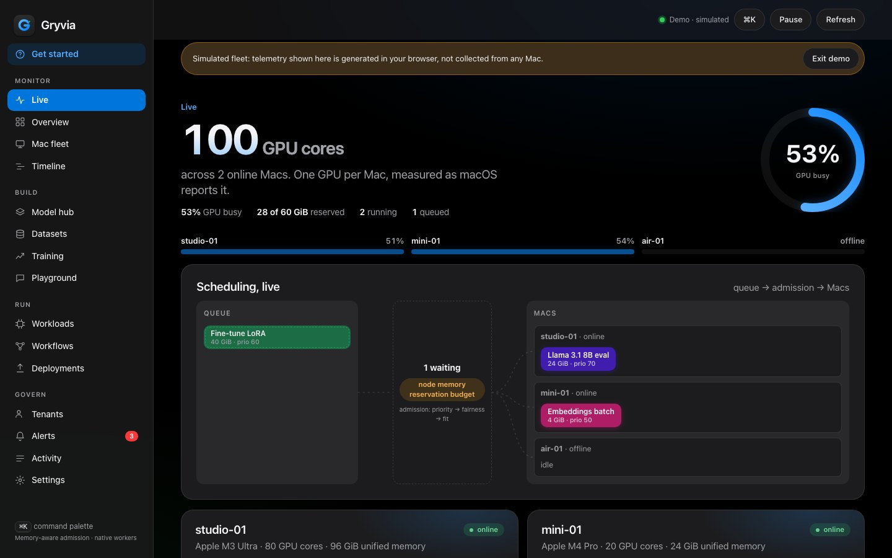

<div align="center">


# Gryvia for Apple Silicon

[](https://github.com/zyvorai/zyvor-gryvia-apple/actions/workflows/ci.yml)
[](LICENSE)
[](docs/TESTING.md)
[](server/app.py)
[](native/Package.swift)



### Your Macs, scheduled.

**A multi-tenant control plane for Apple Silicon fleets.** It admits and places inference, fine-tuning and benchmark jobs against each Mac's unified-memory budget, with quotas, leases, provenance and a live view of every GPU.

**Memory-aware admission** · **Live GPU cores** · **Model workbench** · **Owner-aware** · **Signed provenance** · **Source-available**

🎮 **[Live demo](https://zyvorai.github.io/zyvor-gryvia-apple/demo/)** · 🌐 **[Site](https://zyvorai.github.io/zyvor-gryvia-apple/)** · 🚀 **[Quickstart](#quickstart)** · 📖 **[Getting started](docs/GETTING-STARTED.md)** · 🔒 **[Security](SECURITY.md)** · 📦 **[Releases](docs/RELEASE.md)** · 🧪 **[Results](TEST_RESULTS.md)**

</div>

> **Zyvor AI Labs · 0.4.0 · BUSL-1.1.** Source-available (not OSI open source); each version converts to Apache-2.0 four years after its first public release. Copyright © 2026 Zyvor AI Labs Private Limited.

## Why Gryvia

| When this happens | Gryvia gives you |
|---|---|
| Three Macs, five jobs, and nobody knows what fits where | **Admission control** against each Mac's unified-memory budget, with priorities, tenant quotas and fairness weights |
| "Is the mini alive, and is it throttling?" | A live fleet view: GPU cores lit by measured utilisation, thermal state, drain and resume, alerts |
| The Mac on someone's desk should not run your 3 am fine-tune while they are working | **Owner policy**: run only when idle, yield instantly when they return, respect battery, Low Power Mode and calls |
| "Which Mac produced this model, and was it tampered with?" | **Signed provenance**: node-signed attestations, pinned keys, verified chains, an optional deploy gate |
| You want an AI assistant to check or operate the fleet | **MCP server** (read-only by default) and Shortcuts actions |
| You want to try it without hardware | **Demo mode**: a clearly labelled simulated fleet in the browser |

## What is in the box

- **Control plane** (`server/`): Python standard library + SQLite. Priority, fairness, quotas, dependencies, retries, leases, yield-and-resume, model registry, results, provenance, OpenAI-style gateway with streaming over an outbound agent relay, idle-deployment eviction and a capacity summary, Prometheus `/metrics`.
- **Agent** (`native/Sources/GryviaAgent`): Swift. Reports GPU model, core count and measured utilisation (IORegistry), memory, thermal state, owner presence and power; runs locally configured runtimes; signs attestations.
- **Apps**: web dashboard (`web/`, also the static demo), SwiftUI Mac app with menu-bar pause and Dock badge, CLI (`scripts/gryvia.py`), MCP server (`mcp/`).
- **Runtimes** (`runtimes/`): llama.cpp (bench, evaluate, quantise, serve), MLX (LoRA, fuse, serve, generate), Core ML, Hugging Face download with size cap and SHA-256.

## Quickstart

1. **Look around, no install.** Open the [live demo](https://zyvorai.github.io/zyvor-gryvia-apple/demo/) and press **Try demo**.
2. **Run it on this Mac.**
   ```bash
   make run-server     # control plane; creates ./local with tokens (0600)
   make run-agent      # in another terminal: this Mac becomes a worker
   open http://127.0.0.1:8443   # paste GRYVIA_ADMIN_TOKEN from local/credentials.env, press "Run demo job"
   ```
3. **Enrol another Mac.** `make deploy MINI=your-mac` syncs, builds, tests and installs launchd services over ssh. `python3 scripts/gryvia.py quickstart` tells you what to do next.

Install the app instead: `brew install --cask zyvorai/tap/gryvia`, or download the DMG or pkg from the [releases](https://github.com/zyvorai/zyvor-gryvia-apple/releases). The **v0.4.0 DMG is Developer ID signed and notarized** (Apple's notary service accepted it and the ticket is stapled); the pkg and zip are not signed or notarized, and builds made by CI without signing secrets are ad hoc signed. Verify with `shasum -a 256 -c`; for an ad hoc or unsigned build, Control-click → Open.


**Free to read, build and test; paid to run for real work.** The source is under the Business Source License 1.1 (see [LICENSE](LICENSE), the authority; v0.4.0 and earlier keep their original personal-use grant). **Pricing (GST invoice included).** **Personal ₹420 one-time (about US$4.99), for one person and no business use**, bought [here](https://rzp.io/rzp/7A92MBZr). **Solo / small team ₹4,999 per year (about US$59), up to 5 Macs; Team ₹19,999 per year (about US$239), up to 25 Macs;** larger fleets and several entities by quote at sales@zyvor.dev. The same Developer ID signed and notarized build for every plan; no redistribution or resale. Terms: [docs/COMMERCIAL-LICENSE.md](docs/COMMERCIAL-LICENSE.md) (draft).

## Honest limits

One GPU per Mac; GPU utilisation is device-wide, not per job; reservations are admission bookkeeping, not isolation; energy is an estimate and needs an optional root helper; training is single-Mac LoRA; there is no sandbox around runtimes, so enrol only Macs you would let an admin run code on. See [SECURITY.md](SECURITY.md) and [TEST_RESULTS.md](TEST_RESULTS.md) for what was measured, on what, and what was not verified.

## Fleet reliability additions

Outbound agent inference relay, staged artifact locations with input checksums, live memory-pressure admission, a model-fit advisor, safer subprocess cleanup and seeded training splits are described in [Fleet reliability](docs/FLEET-RELIABILITY.md). They are built and tested on macOS 27.2 and run on a Mac mini. Relay between two physical Macs is not yet measured; see that page's validation status.

**New in 0.4:** serve one model from several Macs (`gryvia deploy MODEL --node A --node B`, least-busy routing, one failover before the first byte), opt-in automatic idle eviction (`autoEvictIdleSeconds`), and an Idle deployments panel on the Overview. Step-by-step: [Getting started](docs/GETTING-STARTED.md). Cross-Mac replicas are not yet measured on two physical Macs.

**Idle eviction.** `GET /api/models/idle` lists deployments with no gateway traffic within a window, and `POST /api/models/evict-idle` stops them to free their memory reservation. It is operator-triggered, with no autoscaler. `GET /api/capacity` gives the free and reserved GiB picture. See [Operations](docs/OPERATIONS.md#idle-eviction-and-capacity).

## Where it fits

Gryvia is not a way to split one model across Macs (see exo and MLX distributed for that). It answers who gets which Mac, when, and within what limits. [docs/COMPARISON.md](docs/COMPARISON.md) has the longer comparison.

## Docs

[Getting started](docs/GETTING-STARTED.md) · [Architecture](docs/ARCHITECTURE.md) · [Operations](docs/OPERATIONS.md) · [UX contract](docs/UX-CONTRACT.md) · [Testing](docs/TESTING.md) · [Release](docs/RELEASE.md) · [Feature matrix](docs/FEATURE_MATRIX.md) · [Contributing](CONTRIBUTING.md) · [Changelog](CHANGELOG.md)
